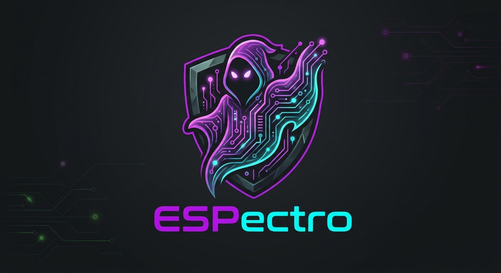

# ESPectro

<p align="center">
  <a href="README.md">🇬🇧 English</a> · <a href="README.es.md">🇪🇸 Español</a>
</p>

<p align="center">
  
</p>

<p align="center">
  
  
  
  
  
</p>

🚧 **En construcción** — el hardware y la documentación todavía se están desarrollando.

Un dispositivo DIY multifunción de pentesting basado en el firmware [ESP-HACK](https://github.com/Teapot174/ESP-HACK).

## Índice

- [Estado del proyecto](#estado-del-proyecto)
- [Lista de materiales](#lista-de-materiales)
- [Guía de cableado](#guía-de-cableado)
- [Problemas conocidos y decisiones de diseño](#problemas-conocidos-y-decisiones-de-diseño)
- [Instalación del firmware](#instalación-del-firmware)
- [Aviso legal](#aviso-legal)
- [Créditos](#créditos)

## Estado del proyecto

**ESPectro-0** (prototipo) — funcional, pendiente de carcasa:

- [x] Componentes seleccionados y pedidos (BOM)
- [x] Montado sobre la PCB de referencia de ESP-HACK (sin separar / plano)
- [x] Firmware compilado y flasheado (fork ESPectro, entorno SH1106)
- [x] Todos los módulos cableados y probados: OLED, Wi-Fi, BT, microSD, CC1101 (SubGHz), IR TX/RX
- [x] Cableado y pinouts documentados ([Notas de montaje](docs/ASSEMBLY-NOTES.es.md))
- [ ] Carcasa / case 3D
- [ ] Fotos finales del dispositivo montado
- [ ] Montar las unidades restantes (separar por el V-score + apilar)

## Lista de materiales

Componentes para **una** unidad de **ESPectro** montada, con enlace de compra.
_(Precios aproximados, IVA incluido; envío y herramientas de soldadura no incluidos.)_

| Uds | Componente | Compra | Precio aprox. unidad |
| --- | --- | --- | --- |
| 1 | PCB a medida — diseño de referencia oficial de ESP-HACK | [JLCPCB](https://jlcpcb.com/) | 4,31 € |
| 1 | ESP32 Dev Kit (WROOM-32, 38 pines) — AZDelivery | [Amazon.es](https://www.amazon.es/dp/B0DHY22H5B) | 15,04 € |
| 1 | Módulo RF CC1101 433 MHz — ICQUANZX | [Amazon.es](https://www.amazon.es/dp/B07YX92NMP) | 8,99 € |
| 1 | Pantalla OLED 1.3" (SH1106, I²C) — ½ de un pack de 2 | [Amazon.es](https://www.amazon.es/dp/B0DFCKSWH9) | ≈6,00 € |
| 4 | Botones táctiles 6×6 mm, **2 pines SMD** — 4 de un pack de 20 | [AliExpress](https://es.aliexpress.com/item/4000678658427.html) | ≈0,44 € |
| 1 | Módulo microSD **3.3V** (mini, pinout `3V3·CS·MOSI·CLK·MISO·GND`) — Create idea, 1 de un pack de 10 | [Amazon.es](https://www.amazon.es/dp/B0DRXBF5RW) | ≈1,40 € |
| 1 | Kit emisor/receptor IR, 38 kHz (940 nm) | [Bricogeek](https://tienda.bricogeek.com/sensores-luz-infrarrojos/2122-kit-emisor-y-receptor-ir-38khz-940nm.html) | 2,80 € |
| ~2 tiras | Tiras de pines **hembra** 2,54 mm — cortadas a medida por módulo | [Amazon.es](https://www.amazon.es/ANGEEK-Single-Breakable-Connector-Arduino/dp/B07XXXNH9V) | ≈0,48 € |

**Coste aprox. por unidad: ≈ 39,46 €** _(sin envío ni herramientas de soldadura)._

> ⚠️ **Nota sobre el módulo microSD:** esta placa necesita el módulo **mini de 3.3 V** con el orden de pines `3V3 · CS · MOSI · CLK · MISO · GND` (VCC y GND en extremos opuestos). El típico adaptador grande "Micro SD Card Adapter" (orden `CS·SCK·MOSI·MISO·VCC·GND`, con conversor de nivel de 5 V) **no** encaja en este footprint.

## Guía de cableado

Pinouts completos, detalles de cableado y lecciones aprendidas del montaje
del prototipo ESPectro-0 están documentados aquí:

📄 [Notas de montaje (ES)](docs/ASSEMBLY-NOTES.es.md) · [Assembly Notes (EN)](docs/ASSEMBLY-NOTES.md)

### Display OLED (SH1106, I²C) — ✅ Soldado y verificado

| Pin del display | GPIO del ESP32 |
|---|---|
| VCC | 3V3 |
| GND | GND |
| SDA | G21 |
| SCL | G22 |

### Pulsadores de navegación — ✅ Soldado y verificado

Cada pulsador conecta una pata al GPIO indicado y la otra a GND (el firmware usa pull-ups internas).

| Función | GPIO del ESP32 |
|---|---|
| UP | G27 |
| DOWN | G26 |
| OK | G33 |
| BACK | G32 |

### Módulo CC1101 433MHz (SPI) — ✅ Soldado y verificado

| Pin del CC1101 | GPIO del ESP32 |
|---|---|
| VCC | 3V3 |
| GND | GND |
| SCK | G18 |
| MOSI | G23 |
| MISO | G19 |
| CSN (CS) | G5 |
| GDO0 | G4 |

### Módulo microSD (bus SPI dedicado) — ✅ Soldado y verificado

| Pin del módulo SD | GPIO del ESP32 |
|---|---|
| VCC | 3V3 |
| GND | GND |
| CS | G15 |
| MOSI | G13 |
| SCK (CLK) | G14 |
| MISO | G17 |

> La tarjeta SD funciona con su propia instancia SPI dedicada en firmware (`sdSPI`), independiente del bus SPI hardware del CC1101 de arriba — no comparten pines.

### Emisor / receptor IR — ✅ Soldado y verificado

| Señal | GPIO del ESP32 |
|---|---|
| IR TX (emisor) | G16 |
| IR RX (receptor) | G35 |


## Problemas conocidos y decisiones de diseño

**Prototipado en breadboard — descartado.** El prototipado inicial usaba dos breadboards de 830 puntos con jumpers DuPont Hembra-Hembra directos al header del ESP32. Se abandonó tras fallos de contacto repetidos en los pines del header — el ajuste por fricción se degradaba rápido con el uso normal, haciendo la placa poco fiable más allá de pruebas cortas de banco.

**Resuelto: PCB de referencia oficial en lugar de diseño propio o perfboard.** En vez de diseñar una PCB desde cero o pasar a perfboard con soldadura manual, este montaje usa la **PCB de referencia oficial de ESP-HACK**, cuyos archivos Gerber publica el propio autor del firmware en la carpeta `/others` del repositorio original (diseño acreditado a **Teapot174** y **Dripside**). Reutilizar el diseño de referencia ya probado:

- garantiza que el pinout físico coincide exactamente con el mapa de GPIO del firmware (`src/CONFIG.h`), sin riesgo de descuadre entre cableado y firmware,
- ahorra por completo el tiempo de diseño y revisión de la PCB,
- se beneficia del uso previo de ese mismo diseño por la comunidad.

Las placas se pidieron a través de **JLCPCB**, con una llegada estimada de **7 a 10 días hábiles**.

> **Nota sobre la reutilización:** los archivos Gerber no son un diseño propio de este repositorio — pertenecen al proyecto original ESP-HACK. Si los incorporas a tu propio repo en lugar de solo enlazar a la fuente, mantén la atribución original y revisa la licencia del repositorio original antes de redistribuirlos.

📄 **Notas de montaje completas:** [Notas de montaje (ES)](docs/ASSEMBLY-NOTES.es.md) · [Assembly Notes (EN)](docs/ASSEMBLY-NOTES.md)

## Instalación del firmware

El firmware de ESPectro está en este repo, en [`firmware/`](firmware/). Es un
fork de [ESP-HACK](https://github.com/Teapot174/ESP-HACK) de **Teapot174** —
ver [`firmware/NOTICE.md`](firmware/NOTICE.md) para atribución y cambios.

### Requisitos previos

- [VS Code](https://code.visualstudio.com/) con la extensión **PlatformIO**
  (o PlatformIO Core / CLI `pio`)
- Un **cable USB-C de datos** (no solo de carga)
- Driver USB-a-UART si tu placa lo necesita (CP2102 o CH340)

### Pasos

1. Clona este repositorio y entra en la carpeta del firmware:
   ```bash
   git clone https://github.com/lank-one/ESPectro.git
   cd ESPectro/firmware
   ```
2. Abre la carpeta `firmware/` en **VS Code** (PlatformIO la detecta solo).
3. Conecta el ESP32 por USB-C y confirma que se detecta:
   ```bash
   pio device list
   ```
4. Compila y flashea con el entorno **SH1106**:
   ```bash
   pio run -e SH1106 --target upload
   ```
   (En la barra de PlatformIO también puedes darle a **Upload** — compila y
   flashea de una.)
5. *(Opcional)* Abre el monitor serie: `pio device monitor`
6. *(Opcional)* Prepara la microSD — ver las
   [Notas de montaje](docs/ASSEMBLY-NOTES.es.md) y el
   [README del firmware](firmware/README.md).

> Si el flasheo falla con *"chip stopped responding"*, reintenta, usa un buen
> cable de datos en un puerto USB directo, y añade `upload_speed = 115200` al
> `platformio.ini`.

## Aviso legal

Este proyecto es una guía de construcción de hardware para un dispositivo que ejecuta el firmware de terceros y de código abierto **ESP-HACK**. Se publica estrictamente con fines educativos y de investigación de seguridad autorizada.

Al construir y/o usar este dispositivo, aceptas lo siguiente, que refleja el propio disclaimer del proyecto original:

> "Este firmware está diseñado exclusivamente para fines de investigación y pruebas de hardware. Al usar el firmware, debes cumplir con las leyes de tu región. El creador del firmware no se hace responsable de tus acciones."

Además:

- **Eres el único responsable del uso que le des a este dispositivo.** Utilízalo únicamente contra sistemas, redes y dispositivos RF que sean de tu propiedad o para los que tengas autorización explícita y por escrito.
- **El jamming (interferencia de señal) es ilegal en la mayoría de jurisdicciones**, y el propio autor del firmware original lo señala explícitamente como tal. Cualquier funcionalidad de ESP-HACK en Sub-GHz o NRF24 que constituya jamming está presente en el firmware únicamente con fines de documentación/investigación en laboratorio y **no debe usarse** para interrumpir servicios de radio con licencia, comunicaciones de emergencia, ni ningún equipo de terceros.
- **Las funciones disruptivas de Wi-Fi y Bluetooth** (deautenticación, beacon spam, BLE spam, evil portal, etc.) pueden vulnerar leyes de telecomunicaciones y de uso indebido informático en muchos países, incluso en redes que creas "abandonadas" o "públicas". Confirma que tienes autorización antes de usarlas.
- **Las funciones de emulación/clonado de RFID, iButton o NFC** pueden estar reguladas según tu jurisdicción y el tipo de credencial. No clones ni emules credenciales de acceso para las que no tengas autorización.
- El autor de este repositorio (la documentación de construcción del hardware) **no es el desarrollador de ESP-HACK** y no asume ninguna responsabilidad sobre el uso que terceros hagan del firmware o del dispositivo montado.
- Este proyecto se publica únicamente con fines de investigación y educativos. **El autor no se hace responsable de un mal uso, daños o consecuencias legales derivadas de la construcción o el funcionamiento de este dispositivo.**

Si tienes dudas sobre si un caso de uso concreto es legal en tu país, consulta la normativa local de telecomunicaciones y de uso indebido informático, o a un profesional legal cualificado, antes de proceder.

## Créditos

- **Firmware:** [ESP-HACK](https://github.com/Teapot174/ESP-HACK) de Teapot174, licenciado bajo AGPL-3.0
- **Diseño de la PCB de referencia:** Teapot174 y Dripside — archivos Gerber publicados en la carpeta `/others` del repositorio original
- **Montaje de hardware, documentación de cableado y este repositorio:** [lank-one](https://github.com/lank-one)

## Licencia

Este repositorio contiene dos partes con licencias distintas:

- **Documentación, notas de hardware y branding** (todo lo que está fuera de
  `firmware/`): bajo **Licencia MIT** — ver [`LICENSE`](LICENSE).
- **Firmware** (la carpeta `firmware/`): bajo
  **GNU Affero General Public License v3.0 (AGPL-3.0)** — ver
  [`firmware/LICENSE`](firmware/LICENSE). Es un fork de
  [ESP-HACK](https://github.com/Teapot174/ESP-HACK) de **Teapot174** y
  hereda su licencia. Ver [`firmware/NOTICE.md`](firmware/NOTICE.md) para la
  atribución y la lista de cambios.

