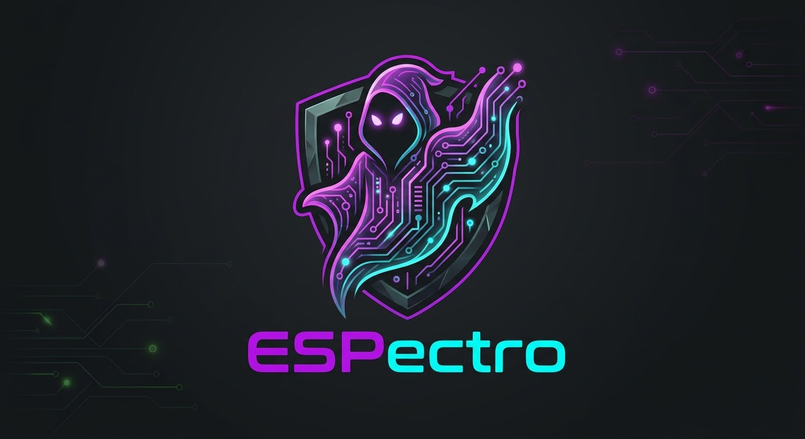

# ESPectro

<p align="center">
  <a href="README.md">🇬🇧 English</a> · <a href="README.es.md">🇪🇸 Español</a>
</p>

<p align="center">
  
</p>

<p align="center">
  
  
  
  
</p>

🚧 **Work in progress** — hardware and documentation are still being built.

A DIY multi-function pentesting device built on the [ESP-HACK](https://github.com/Teapot174/ESP-HACK) firmware.

## Table of Contents

- [Project Status](#project-status)
- [Bill of Materials](#bill-of-materials)
- [Wiring Guide](#wiring-guide)
- [Known Issues & Design Decisions](#known-issues--design-decisions)
- [Firmware Installation](#firmware-installation)
- [Legal Disclaimer](#legal-disclaimer)
- [Credits](#credits)

## Project Status

- [x] Components selected and ordered (BOM)
- [x] Firmware built and flashed — ESP-HACK v1.2, `SH1106` display environment, jammer functionality disabled (see [Firmware Installation](#firmware-installation))
- [x] OLED display wired and verified (SDA→G21, SCL→G22)
- [x] Custom PCB received — official ESP-HACK reference design (Gerbers by Teapot174 / Dripside, from the upstream repository's `/others` folder), manufactured via JLCPCB
- [x] Breadboard prototyping discontinued — persistent contact reliability issues with the ESP32 header pins (see [Known Issues & Design Decisions](#known-issues--design-decisions))
- [ ] Final assembly on PCB — not started yet, soldering to begin as time allows
- [ ] microSD module — functional verification
- [ ] CC1101 module — wiring and testing
- [ ] Buttons — wiring and testing
- [ ] IR emitter/receiver — wiring and testing
- [ ] 3D-printed enclosure
- [ ] Full build documentation with photos

## Bill of Materials

Components for **one** assembled **ESPectro**, with purchase links.
_(Approximate prices, VAT included; shipping and soldering tools not included.)_

| Qty | Component | Purchase | Approx. unit price |
| --- | --- | --- | --- |
| 1 | Custom PCB — official ESP-HACK reference design | [JLCPCB](https://jlcpcb.com/) | €4.31 |
| 1 | ESP32 Dev Kit (WROOM-32, 38-pin) — AZDelivery | [Amazon.es](https://www.amazon.es/dp/B0DHY22H5B) | €15.04 |
| 1 | CC1101 433 MHz RF module — ICQUANZX | [Amazon.es](https://www.amazon.es/dp/B07YX92NMP) | €8.99 |
| 1 | 1.3" OLED display (SH1106, I²C) — ½ of a 2-pack | [Amazon.es](https://www.amazon.es/dp/B0DFCKSWH9) | ≈€6.00 |
| 4 | Tactile buttons 6×6 mm, **2-pin SMD** — 4 of a 20-pack | [AliExpress](https://es.aliexpress.com/item/4000678658427.html) | ≈€0.44 |
| 1 | MicroSD module **3.3V** (mini, pinout `3V3·CS·MOSI·CLK·MISO·GND`) — Create idea, 1 of a 10-pack | [Amazon.es](https://www.amazon.es/dp/B0DRXBF5RW) | ≈€1.40 |
| 1 | IR emitter/receiver kit, 38 kHz (940 nm) | [Bricogeek](https://tienda.bricogeek.com/sensores-luz-infrarrojos/2122-kit-emisor-y-receptor-ir-38khz-940nm.html) | €2.80 |
| ~2 strips | 2.54 mm **female** header strips — cut to length per module | [Amazon.es](https://www.amazon.es/ANGEEK-Single-Breakable-Connector-Arduino/dp/B07XXXNH9V) | ≈€0.48 |

**Approx. cost per unit: ≈ €39.46** _(excludes shipping and soldering tools)._

> ⚠️ **MicroSD module note:** this board needs the **3.3 V mini** module with pin order `3V3 · CS · MOSI · CLK · MISO · GND` (VCC and GND at opposite ends). The common large "Micro SD Card Adapter" (order `CS·SCK·MOSI·MISO·VCC·GND`, with a 5 V level-shifter) does **not** fit this footprint.


## Wiring Guide

The pinout below is sourced directly from ESP-HACK's firmware configuration (`src/CONFIG.h`) — the same GPIO map used by the official reference PCB this build is based on, so it applies whether you build on the PCB, on perfboard, or on a breadboard for testing.

### OLED Display (SH1106, I²C) — ✅ Wired & verified

| Display Pin | ESP32 GPIO |
|---|---|
| VCC | 3V3 |
| GND | GND |
| SDA | G21 |
| SCL | G22 |

### Navigation Buttons — ✅ Wired & verified

Each button connects one leg to the listed GPIO, the other to GND (firmware uses internal pull-ups).

| Function | ESP32 GPIO |
|---|---|
| UP | G27 |
| DOWN | G26 |
| OK | G33 |
| BACK | G32 |

### CC1101 433MHz Module (SPI) — ⏳ Pending assembly (PCB)

| CC1101 Pin | ESP32 GPIO |
|---|---|
| VCC | 3V3 |
| GND | GND |
| SCK | G18 |
| MOSI | G23 |
| MISO | G19 |
| CSN (CS) | G5 |
| GDO0 | G4 |

### microSD Module (dedicated SPI bus) — ⏳ Wired, functional verification pending

| SD Module Pin | ESP32 GPIO |
|---|---|
| VCC | 3V3 |
| GND | GND |
| CS | G15 |
| MOSI | G13 |
| SCK (CLK) | G14 |
| MISO | G17 |

> The SD card runs on its own dedicated SPI instance in firmware (`sdSPI`), separate from the CC1101's hardware SPI bus above — the two do not share pins.

### Infrared Emitter / Receiver — ⏳ Pending assembly (PCB)

| Signal | ESP32 GPIO |
|---|---|
| IR TX (emitter) | G16 |
| IR RX (receiver) | G35 |

### Optional GPIO Expansion Header

Reserved for add-on modules (iButton, NRF24, ST25R3916/RFID):

| Label | ESP32 GPIO | Shared with |
|---|---|---|
| GPIO_A | G16 | IR TX |
| GPIO_B | G2 | — |
| GPIO_C | G18 | CC1101 SCK |
| GPIO_D | G23 | CC1101 MOSI |
| GPIO_E | G19 | CC1101 MISO |
| GPIO_F | G25 | — |

These pins are multiplexed with other peripherals by design — only wire an add-on to a shared pin if the corresponding peripheral isn't populated on your build.

## Known Issues & Design Decisions

**Breadboard prototyping — discontinued.** Early prototyping used two 830-point breadboards with Female-Female DuPont jumpers wired directly into the ESP32 header. This was abandoned after repeated contact/connection failures on the header pins — the friction-fit sockets degraded quickly under normal handling, making the board unreliable beyond short bench tests.

**Resolved: official reference PCB instead of a custom design or perfboard.** Rather than designing a PCB from scratch or moving to perfboard and hand soldering, this build uses the **official ESP-HACK reference PCB**, whose Gerber files are published by the firmware author in the upstream repository's `/others` folder (design credited to **Teapot174** and **Dripside**). Reusing the vetted reference design:

- guarantees the physical pinout matches the firmware's hardcoded GPIO map (`src/CONFIG.h`) exactly, with no risk of a wiring-to-firmware mismatch,
- skips PCB design and review time entirely,
- benefits from prior community use of that same layout.

Boards were ordered through **JLCPCB**, with an estimated delivery of **7–10 business days**.

> **Note on reuse:** the Gerber files are not this repository's own design — they belong to the upstream ESP-HACK project. If you mirror them into your own repo rather than only linking to the source, keep the original attribution intact and check the upstream repository's license before redistributing.

## Firmware Installation

ESP-HACK is built with [PlatformIO](https://platformio.org/), targeting the Arduino framework for the `esp32dev` board, with two selectable build environments depending on your OLED controller:

```ini
[platformio]
default_envs =
    SH1106
    SSD1306

[env]
platform = espressif32
board = esp32dev
framework = arduino
monitor_speed = 115200
board_build.partitions = partitions_ota.csv

lib_deps =
    adafruit/Adafruit SH110X@^2.1.14
    adafruit/Adafruit SSD1306@^2.5.17
    gyverlibs/GyverButton@^3.8
    crankyoldgit/IRremoteESP8266@^2.9.0
    lsatan/SmartRC-CC1101-Driver-Lib@^3.0.2
    sui77/rc-switch@^2.6.4
    h2zero/NimBLE-Arduino@^2.5.0
    nrf24/RF24@^1.6.1
    paulstoffregen/OneWire@^2.3.8
    olikraus/U8g2_for_Adafruit_GFX@^1.8.0

extra_scripts =
    post:build.py

[env:SH1106]
build_flags =
    -Wl,-z,muldefs
    -D DISPLAY_TYPE=DISPLAY_SH1106

[env:SSD1306]
build_flags =
    -Wl,-z,muldefs
    -D DISPLAY_TYPE=DISPLAY_SSD1306
```

This build uses the **`SH1106`** environment, matching the OLED module in the [Bill of Materials](#bill-of-materials). Pin mapping and the firmware version constant both live in `src/CONFIG.h` — see the [Wiring Guide](#wiring-guide) for the complete GPIO map used by this build.

### Prerequisites

- [Visual Studio Code](https://code.visualstudio.com/) with the [PlatformIO IDE extension](https://platformio.org/platformio-ide), **or** the [PlatformIO Core CLI](https://docs.platformio.org/en/latest/core/installation/index.html)
- A USB data cable connecting the ESP32-WROOM-32 board to your computer
- The correct USB-to-UART driver for your board (typically CP2102 or CH340) installed on your host OS

### Steps

1. **Clone the upstream firmware.** The original repository is archived (read-only), so fork it on GitHub first if you plan to make changes, then clone your fork (or the original, for a straight build):
```bash
   git clone https://github.com/Teapot174/ESP-HACK.git
   cd ESP-HACK
```
2. **Open the project in PlatformIO.** In VS Code: `File → Open Folder` → select the cloned `ESP-HACK` folder. PlatformIO detects `platformio.ini` automatically and resolves the `lib_deps` dependencies on first build.
3. **(Recommended) Disable jammer functionality.** ESP-HACK includes a Sub-GHz jammer (`startJamming()` / `stopJamming()` in `src/subghz.cpp`) that drives the CC1101 into continuous-carrier transmission. This build disables it by stubbing out `startJamming()` so the menu entry still exists but never keys the radio:
```cpp
   void startJamming() {
     Serial.println(F("Jammer disabled in this build"));
     return;
   }
```
   Replace the original function body (the block that calls `ELECHOUSE_cc1101.SetTx()` and writes registers `0x3E`/`0x35`) with the snippet above. See the [Legal Disclaimer](#legal-disclaimer) for why jamming is excluded from this build.
4. **Connect the ESP32 board** via USB and confirm it is detected:
```bash
   pio device list
```
5. **Build the firmware**, specifying the environment that matches your display:
```bash
   pio run -e SH1106
```
6. **Flash it**, using the same environment flag so PlatformIO applies the correct `partitions_ota.csv` partition scheme automatically:
```bash
   pio run -e SH1106 --target upload
```
7. **Monitor the serial output** to confirm a successful boot:
```bash
   pio device monitor -b 115200
```
8. **(Optional) SD card content.** ESP-HACK can load additional content/updates from a FAT32-formatted microSD card — see the [ESP-HACK wiki](https://teapot174.github.io) for the expected folder structure.

> ⚠️ Flash this on a bare ESP32 first, before final assembly — it lets you confirm the board boots correctly without mixing firmware issues with wiring issues.

For troubleshooting and feature usage beyond this build guide, see the original documentation:
- Repository: https://github.com/Teapot174/ESP-HACK
- Wiki: https://teapot174.github.io

## Legal Disclaimer

This project is a hardware build guide for a device running the third-party, open-source **ESP-HACK** firmware. It is published strictly for educational and authorized security-research purposes.

By building and/or using this device, you agree to the following, which mirrors the upstream project's own disclaimer:

> "This firmware is designed exclusively for research purposes and hardware testing. By using the firmware, you must comply with the laws of your region. The firmware creator is not responsible for your actions."

In addition:

- **You are solely responsible for how you use this device.** Only use it against systems, networks, and RF devices you own or have explicit, written authorization to test.
- **Jamming is illegal in most jurisdictions and is explicitly called out as such by the upstream firmware author.** Any Sub-GHz or NRF24 functionality in ESP-HACK that constitutes RF jamming is present in the firmware for research/lab documentation purposes only and **must not** be used to disrupt licensed radio services, emergency communications, or any third-party equipment.
- **Wi-Fi and Bluetooth disruptive features** (deauthentication, beacon spam, BLE spam, evil portal, etc.) can violate telecommunications and computer-misuse laws in many countries even on networks you believe are "abandoned" or "public." Confirm you have authorization before use.
- **RFID/iButton/NFC emulation and cloning features** may be regulated depending on your jurisdiction and the credential type. Do not clone or emulate access credentials you are not authorized to possess or test.
- The author of this repository (the hardware build documentation) is **not the developer of ESP-HACK** and assumes no liability for how the firmware or the assembled device is used by third parties.
- This project is released for research and educational purposes only. **The author accepts no responsibility for misuse, damages, or legal consequences arising from the construction or operation of this device.**

If you are unsure whether a specific use case is legal in your country, consult local telecommunications and computer-misuse regulations, or a qualified legal professional, before proceeding.

## Credits

- **Firmware:** [ESP-HACK](https://github.com/Teapot174/ESP-HACK) by Teapot174, licensed under AGPL-3.0
- **Reference PCB design:** Teapot174 and Dripside — Gerber files published in the upstream repository's `/others` folder
- **Hardware build, wiring documentation, and this repository:** [lank-one](https://github.com/lank-one)
